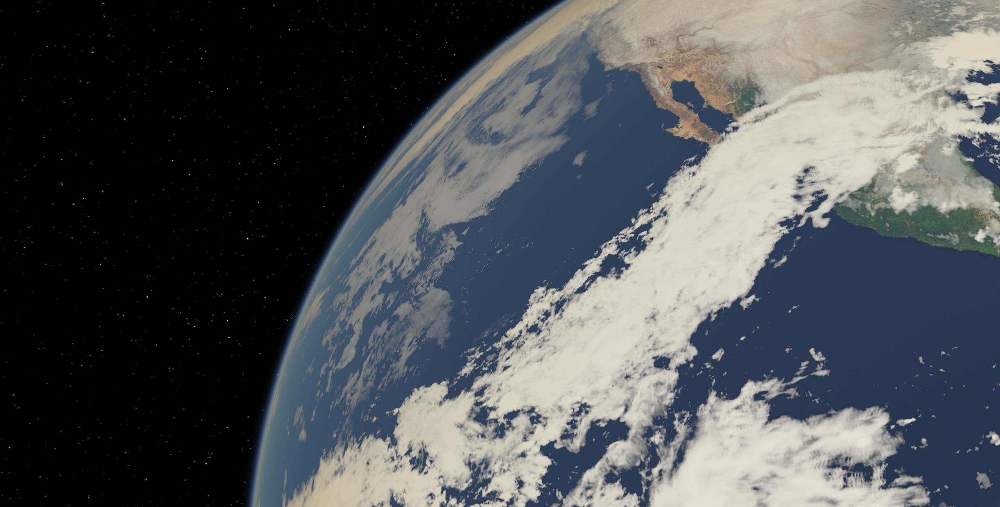
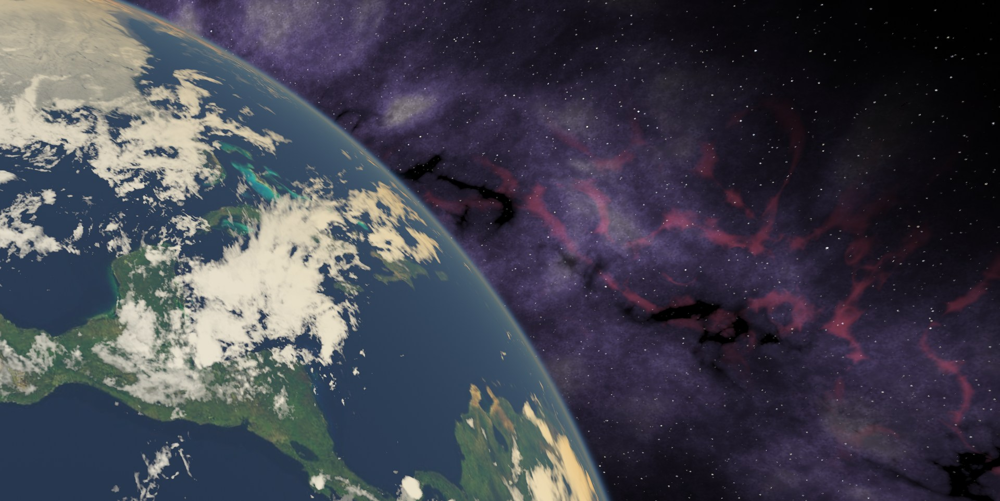

# RTWallpaper — fondos de pantalla con Ray Tracing real (DXR)

Fondos de escritorio animados para Windows que usan **DirectX Raytracing (DXR 1.0)** nativo en la GPU, en tiempo real.
Incluye varias escenas que se eligen en un archivo de configuración.

## Descargar

**[⬇ RTWallpaper-v1.0.0-win-x64.zip](https://github.com/AdanRuiz/RTWallpaper/releases/latest/download/RTWallpaper-v1.0.0-win-x64.zip)** (≈200 KB): el `.exe` listo para usar, sin dependencias, más `RTWallpaper.ini` y `LEEME.txt`. También está en la página de [Releases](https://github.com/AdanRuiz/RTWallpaper/releases).

1. Descomprime el zip en cualquier carpeta.
2. Ejecuta `RTWallpaper.exe --wallpaper` para ponerlo de fondo, o `RTWallpaper.exe` para verlo en una ventana.
3. Elige la escena (`marble` o `space`) en `RTWallpaper.ini` o desde el icono de la bandeja.

Requiere Windows 10/11 y una GPU con DirectX Raytracing (NVIDIA RTX, AMD RX 6000+, Intel Arc). El ejecutable no está firmado, así que Windows SmartScreen puede avisar: usa **Más información → Ejecutar de todas formas**.

## Capturas

Escena `space` como fondo de escritorio en una configuración de dos monitores (una sola escena repartida entre ambos):

| Monitor 1 (principal, 2560×1440) | Monitor 2 (1920×1080) |
|---|---|
|  |  |

> Capturadas el 11 de noviembre de 2026 a las 11:00 (hora de México): texturas de la NASA y las nubes reales de ese momento.

| Escena | Diseño | Qué hay |
|---|---|---|
| `marble` | [`ray_tracing_windows_desktop_wallpaper.md`](ray_tracing_windows_desktop_wallpaper.md) | Piso de mármol negro con reflexión Fresnel y sombras; 3 esferas de cuarzo exactas con refracción de Snell, reflexión interna total y absorción de Beer; 2 luces de neón; movimiento con OpenSimplex2 ([FastNoiseLite](https://github.com/Auburn/FastNoiseLite)). |
| `space` | [`space_rtx_wallpaper.md`](space_rtx_wallpaper.md) | **La Tierra real, ahora y a escala real (km)**, con la Vía Láctea al fondo (nubes estelares violetas, nebulosas H-alfa rojas y grietas de polvo oscuro): mapas 8K de la NASA (Blue Marble día / Black Marble noche), **nubes reales** (se consultan cada hora), rotación terrestre y posición del Sol según el reloj UTC (distancia ≈ 1 UA), atmósfera física Rayleigh + Mie, reflejo del Sol en el océano, luces de ciudades. **ISS y Hubble** en sus órbitas reales (TLE de Celestrak, Kepler + J2: 7.65 km/s, 92.9 min). La cámara empieza mirando hacia México y luego sigue a la ISS; siempre mantiene la Tierra en el 40–60 % de la pantalla. |

La escena `space` descarga sus datos la primera vez (~30 MB, unos 45 s) en `%LOCALAPPDATA%\RTWallpaper\cache` y después funciona también sin conexión. Los detalles están en [`space_rtx_wallpaper.md`](space_rtx_wallpaper.md).

## Requisitos

- Windows 10/11 y una GPU con soporte DXR (NVIDIA RTX, AMD RX 6000+, Intel Arc).
- Para compilar: solo **Docker Desktop** (no hace falta Visual Studio).

## Compilar

```powershell
.\build.ps1
```

La primera vez crea la imagen `rtwallpaper-toolchain` (Ubuntu + `clang-cl`/`lld-link` + MSVC CRT y Windows SDK descargados con [xwin](https://github.com/Jake-Shadle/xwin) + [DXC](https://github.com/microsoft/DirectXShaderCompiler) para Linux).
Al construirla aceptas la licencia de Microsoft del SDK/CRT. Después compila:

1. `src/shaders/*.hlsl` → DXIL (`lib_6_3`, firmado con `libdxil.so`) embebido como header.
2. `src/main.cpp` → `build/RTWallpaper.exe` (x64, CRT estático, sin dependencias).

## Configuración (`RTWallpaper.ini`)

Está junto al `.exe` (se crea solo si falta). **Los cambios se aplican al guardar**, sin reiniciar:

```ini
[General]
; Escena: marble | space
Scene=space
; Límite de FPS (menos = menos GPU; 30 es suficiente: el movimiento es lento)
FPS=30
; Velocidad de la animación (1.0 = como en el diseño, 0.5 = la mitad)
Speed=1.0

[Space]
TextureSize=8192          ; mapas de la Tierra (8K)
CloudSize=8192            ; mapa de nubes en vivo
CloudUpdateMinutes=60     ; cada cuánto se consultan las nubes
SatelliteScale=1000       ; tamaño visual de los satélites (a escala real no se verían)
CoverageMin=0.40          ; fracción de la pantalla que ocupa la Tierra
CoverageMax=0.60
Offline=0
TimeOffsetHours=0         ; ver la Tierra a otra hora
FocusLat=23.6             ; punto inicial que mira la cámara (México)
FocusLon=-102.5
FocusMinutes=20           ; minutos sobre ese punto antes de seguir a la ISS (-1 = siempre)
Galaxy=scenic             ; scenic (Vía Láctea siempre a la vista) | real (orientación astronómica)
```

También puedes cambiar de escena desde el icono de la bandeja (modo fondo) o con **Tab** (modo ventana).

## Uso

```powershell
build\RTWallpaper.exe               # en una ventana (Esc para salir)
build\RTWallpaper.exe --wallpaper   # como fondo, detrás de los iconos del escritorio
build\RTWallpaper.exe --stop        # detiene la instancia de fondo
```

Opciones: `--scene marble|space` y `--fps N` (tienen prioridad sobre el .ini), `--debug` (capa de depuración de D3D12).

En modo `--wallpaper`:
- Aparece un icono en la bandeja del sistema con: lista de escenas, **Editar configuración**, **Pausar** y **Salir**.
- Se pausa sola cuando hay una app o juego en pantalla completa (GPU a 0%).
- Funciona con el layout del escritorio de Windows 11 24H2+ y con el clásico (WorkerW).
- Para que arranque con Windows: crea un acceso directo con `--wallpaper` en `shell:startup`.

### Con Lively Wallpaper (opcional)

Como en el documento original: en Lively, **Add Wallpaper → Browse** y elige `RTWallpaper.exe` (sin argumentos).

## Estructura

```
src/main.cpp             renderer DXR genérico, config .ini, modo wallpaper, bandeja
src/scenes/Scene.hpp     interfaz de escena (librería DXIL, hit groups, geometría, animación)
src/scenes/*Scene.hpp    escenas: MarbleScene, SpaceScene
src/space/               astronomía/órbitas (Astro.hpp), descargas con ETag (Http.hpp), imágenes WIC + mipmaps (Image.hpp)
tests/astro_test.cpp     pruebas de escala física (velocidades orbitales, distancia al Sol, GMST)
scripts/gen_space_doc.py regenera space_rtx_wallpaper.md con el código real
src/shaders/*.hlsl       shaders DXR de cada escena (se compilan todos automáticamente)
src/shaders/Common.hlsli funciones compartidas por los shaders (rayo de cámara, sombras, esfera)
config/RTWallpaper.ini   configuración por defecto
third_party/             FastNoiseLite.hpp (MIT)
docker/                  toolchain de compilación cruzada
scripts/build.sh         compilación dentro del contenedor
build.ps1                punto de entrada en Windows
```

## Añadir una escena

1. Crea `src/shaders/MiEscena.hlsl` exportando `RayGen`, `Miss`, `ShadowMiss` y tus hit groups (root signature: `u0` salida, `t0` TLAS, `b0` constantes).
2. Crea `src/scenes/MiEscenaScene.h` que herede de `Scene` e incluya `MiEscena.hlsl.h` (`g_pMiEscena`).
3. Regístrala en `kSceneNames` / `CreateScene` en `src/main.cpp`.

## Créditos

El código de este proyecto lo generó **Claude** (Anthropic), y **Adán Ruiz** lo revisó y lo fue iterando.

Datos y bibliotecas de terceros: texturas de la Tierra de NASA GIBS (Blue Marble, Black Marble), mapa de nubes en vivo de [clouds.matteason.co.uk](https://clouds.matteason.co.uk), elementos orbitales de [Celestrak](https://celestrak.org) y [FastNoiseLite](https://github.com/Auburn/FastNoiseLite) (MIT).
